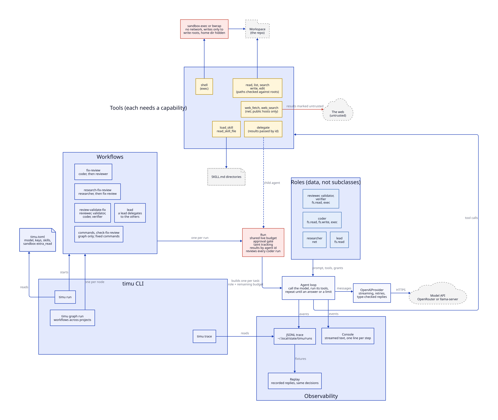

# timu

**timu**—Swahili for *team*—brings together specialised LLM agents, each with a defined role that determines its prompt, tools, and permissions. Workflows coordinate these roles to achieve a shared objective.

Status: alpha. The design is in `docs/dev/design.md`.

## Architecture



The source is `docs/media/architecture.d2`. `make diagrams` regenerates the SVG.

## Roles

| Role | Can | Cannot |
|-|-|-|
| `lead` | read the workspace, delegate to the others | write files, run commands |
| `researcher` | search and fetch the web | touch the workspace |
| `coder` | read, write and edit files, run commands | reach the network |
| `reviewer` | read files, run tests, return a report | change the code |

No role holds network access together with the ability to write files or run commands. Web content, and anything derived from it, reaches other agents only as marked, untrusted data. See design section 6.

## Workflows

A workflow turns one objective into tasks for agents and combines their results. It decides which roles run, in what order, and what passes between them. timu has two kinds (design section 7):

- **Pipeline**: Python code starts agents in a fixed order.
- **Delegation**: a `lead` agent starts other agents with its `delegate` tool, in an order it picks at run time.

The built-in workflows for `timu run`, in `src/timu/workflow.py`:

| Workflow | Kind | Steps |
|-|-|-|
| `fix-review` (default) | pipeline | Coder, then reviewer. One of the report's first three non-empty lines is `VERDICT: APPROVE` or `VERDICT: CHANGES`. `CHANGES` fails the run, unless `--review-to-fix N` sends the report back to the coder up to N times. A report with no verdict fails the run. |
| `research-fix-review` | pipeline | Researcher first. Its findings and source URLs go to the coder as untrusted inputs. Then `fix-review`. |
| `review-validate-fix` | pipeline | Reviewer, validator, coder, verifier. The reviewer reports findings. The validator confirms or rejects each one. The coder fixes the confirmed ones, most severe first. The verifier checks each fix. `--verify-to-fix N` sends unfixed findings back to the coder up to N times. The report lists every finding with each step's verdict. |
| `lead` | delegation | The lead delegates to the researcher, coder and reviewer. Every coder result includes a review, which timu runs, not the lead. Delegation depth is at most 2. |

No step repeats unless a loop flag asks for it. Each loop flag names one back-edge, such as review to fix, and caps how many times it is taken.

Each role can use its own model: set `[roles.<name>] model` in `timu.toml`. `review-validate-fix` uses the roles `reviewer`, `validator`, `coder` and `verifier`.

All agents in a workflow share one `Run`: one budget, one trace, one cancel flag. Each agent gets the smaller of its role's budget and what the run has left. Agents pass work as artifacts that record their origin. They never paste it into a goal, so the untrusted mark survives.

### Adding a workflow

Workflows are code. `timu.toml` cannot define one, and there is no plugin hook. A workflow is a function that takes a `Run` and an objective and returns a `Result`:

```python
def code_then_review(run: Run, objective: str) -> Result:
    coded = run.run_agent(CODER, Task(objective, accept="The tests pass."))
    if coded.status == "done":
        work = Artifact("coder-summary", coded.summary, origin=Origin.AGENT,
                        source=coded.trace_id, untrusted=coded.untrusted)
        coded = run.run_agent(REVIEWER, Task("Review the coder's work.", (work,)))
    run.emit("workflow_result", status=coded.status, summary=coded.summary)
    return replace(coded, usage=run.used, trace_id=run.run_id)
```

To expose it, add a `Workflow` to `WORKFLOWS` in `src/timu/workflow.py`. It names the roles whose providers the CLI checks before the run, and whether `--approve-untrusted` defaults to on. The CLI builds `--workflow` from `WORKFLOWS`.

## Requirements

- Python 3.11 or later. No runtime dependencies.

- A sandbox for the `shell` tool: `sandbox-exec` on macOS, or `bwrap` (bubblewrap) on Linux. Without one, roles that run commands refuse to start unless you pass `--unsafe-no-sandbox`, and timu says why.

  Ubuntu 24.04 and later stop `bwrap` from creating user namespaces (https://ubuntu.com/blog/ubuntu-23-10-restricted-unprivileged-user-namespaces). timu then reports `bwrap cannot create a sandbox here`. An AppArmor profile for `/usr/bin/bwrap` with the `userns` rule allows it; see `docs/dev/bwrap.md`.

- An OpenAI-compatible model API: OpenRouter by default, or a local server such as llama-server. An installed package can add other APIs; see [Providers from packages](#providers-from-packages).

- Optional: a Brave Search API key in `BRAVE_API_KEY`, so the researcher can search as well as fetch.

## Install

```sh
uv sync            # from a checkout; `make help` lists the other targets
uv run timu --help
```

## Configure

timu reads `~/.config/timu/timu.toml`. A minimal file:

```toml
[provider]
model = "openai/gpt-6-luna"              # an OpenRouter model id
# base_url = "http://127.0.0.1:8080/v1"  # a local server instead
# api_key_env = ""                       # a server without a key

[sandbox]
extra_read = ["~/.local/share/uv/python"]  # toolchains under $HOME
```

timu does not read a `timu.toml` in the workspace or the current directory. Models, roles and request settings are yours to choose, not a cloned repo's. `--config PATH` replaces the user file. Each run prints the config it used, for example `config: ~/.config/timu/timu.toml + TIMU_MODEL`. Agents cannot write `timu.toml` or `.timu/` in the workspace.

The API key comes from `OPENROUTER_API_KEY`, or the variable `api_key_env` names. Prefer `api_key_file = "~/.config/timu/openrouter.key"` with mode 600: on macOS a sandboxed command can read the environment of your processes, but not files under `$HOME`. `TIMU_MODEL` and `TIMU_BASE_URL` override the file. `src/timu/config.py` documents every key, including per-role models, skills and the search key.

The sandbox hides `$HOME` from commands. List any toolchain that lives there, such as uv's Python, in `extra_read`, or commands that use it fail.

### Providers from packages

`[provider] type` selects the model client. The default, `chat-completions`, is timu's own OpenAI-compatible client. Any other name is looked up in the `timu.providers` entry-point group, so a separately installed package can add, for example, an SDK-based Anthropic client:

```toml
# the package's pyproject.toml
[project.entry-points."timu.providers"]
anthropic = "timu_sdk.anthropic:from_settings"

# ~/.config/timu/timu.toml
[provider]
type = "anthropic"
model = "claude-opus-5-5"
api_key_file = "~/.config/timu/anthropic.key"
options = { thinking = { budget_tokens = 4096 } }   # passed to the package as is
```

The entry point is a `ProviderFactory`: it takes a `ProviderSettings` and returns a `Provider`. Both are public API in `timu.provider`, and the contract beyond the signatures is in `src/timu/provider/base.py`. For a package's type, `base_url` and `api_key_env` default to empty, so the package's own defaults apply. A package cannot replace `chat-completions`. Only the user's config picks a type, as with every other provider setting.

Roles can use different providers. `[providers.NAME]` takes the keys of `[provider]`, and `[roles.X] provider = "NAME"` selects it:

```toml
[provider]                      # the default: every role without its own provider
model = "openai/gpt-6-luna"

[providers.anthropic]
type = "anthropic"
model = "claude-opus-5-5"

[roles.reviewer]
provider = "anthropic"
```

A role's model is its own `model`, else its provider's. A role on a named provider does not fall back to `[provider].model`, which names another API's model. `TIMU_MODEL` and `TIMU_BASE_URL` change only `[provider]`.

`--max-cost` needs a cost per reply. OpenRouter reports one; OpenAI, Anthropic and local servers do not. For those, set a price in USD per million tokens in the provider table, and timu computes the cost:

```toml
[providers.anthropic]
type = "anthropic"
price = { input = 4.0, output = 20.0, cached_input = 0.2, cache_write = 8.0 }
```

A cost the server reports wins over the price. `cached_input` and `cache_write`, both optional, are the rates for prompt tokens read from and written to a cache; without them those tokens cost the input rate. `cache_write` is one rate for every cache lifetime. Where a longer lifetime costs more, as Anthropic's 1-hour cache does (2x input, against 1.25x for 5 minutes), set the rate of the longest you use; the cost is then an upper bound.

The run summary, `timu trace` and `timu report` show cache reads and writes. A package's provider adapter can check its replies against the contract with `timu.provider.testing.reply_problems`; timu also warns once in a run when a reply counts more cached tokens than input tokens.

## Run

```sh
timu run "make test fails; fix calc.py"
timu run --workflow research-fix-review "upgrade to the current tomllib API"
timu run --workflow lead "add a --json flag to the report command"
```

`--workflow` picks one of the workflows above.

A run works on a `git clone --local` copy under `~/.local/state/timu/work/`, so your checkout does not change. timu commits the changes on a branch in the copy and prints the `git fetch` command that brings it back. The copy starts from `HEAD`: uncommitted changes and gitignored files, such as `.env`, are not in it, and timu warns if the checkout is dirty. The reviewer's report goes to `REVIEW.md` in the copy, or `--report PATH`, and timu prints its path. It stays out of the commit. A run fails without committing if the tree holds a bare git repo, or if files change after the last review.

`--in-place` works in the checkout itself, and is the only choice outside a git repo. Use it only for work you trust. An agent can then plant a repo config, by moving a nested repo or creating a bare one, and git runs that config's commands outside the sandbox when you next run git there.

Useful flags:

- `--max-cost USD` stops the run at a spending limit. All agents share one budget. It needs a server that reports cost, such as OpenRouter; otherwise timu warns and does not enforce it.

- `--approve-untrusted` asks on the terminal before web content reaches the coder, and before a task the lead writes reaches the researcher. It is on by default for `lead`. Without a terminal the answer is no; pass `--no-approve-untrusted` for unattended runs.

- `-v` shows every tool result.

Exit codes: 0 approved or done, 1 failed or refused, 2 usage error, 3 budget spent, 130 interrupted. Press Ctrl-C once to stop after the current step, twice to abort.

## Graphs

A graph runs several workflows across projects, in dependency order. Each node is one workflow on one project. A node can pass outputs to the nodes that need it. The design is in `docs/dev/graph.md`.

List where your projects live in `~/.config/timu/timu.toml`:

```toml
[projects]
roots = ["~/projects"]
```

A graph file names projects by directory name, or as `owner/name` to also check the GitHub `origin`:

```toml
[nodes.a]
repo = "a"
workflow = "fix-review"
objective = "Add a --json flag; bump the minor version"
outputs = { version = "toml:pyproject.toml#project.version", notes = "changelog:latest" }

[nodes.b]
repo = "org/b"
needs = ["a"]
workflow = "fix-review"
objective = "Use a's new --json flag"
inputs = ["a.notes", "a.review"]
```

```sh
timu graph run graph.toml
```

- Each node works on a `git clone --local` copy under `~/.local/state/timu/work/`. Your checkouts are not changed. Uncommitted changes in them are not copied, and timu warns about them.
- timu commits each node's changes on a branch in its copy, as `timu <timu@localhost>`, with your hooks and signing off. Agents cannot commit, and a node whose `HEAD` moved fails. The run prints `git -C <project> fetch <copy> <branch>:<branch>` for each node that changed something.
- If a node does not finish `done`, the nodes that need it are skipped. Other nodes still run.
- Outputs: `toml:FILE#KEY`, `file:GLOB`, `changelog:latest` (the first released section of `CHANGELOG.md`) and `git:diff`. A node also exposes its workflow's results, such as `a.review` or `a.log`.
- `file:GLOB` must match one file. timu copies it out of the copy, and the output is the copy's path. Nodes that need it may read it.
- `${node.output}` may appear only in `params`, and each param is checked against the workflow's schema. Free text reaches a node only through `inputs`.
- Two workflows run commands from the graph file in the sandbox, with no model. `commands` runs `steps` in order. `check-fix-review` runs `check`; if it fails, it runs fix-review with the failure log as an input and checks again. `check_to_fix` and `review_to_fix` allow loops on each edge; both default to 0. Both take `network = true` and `timeout` in seconds per command. `check-fix-review` uses network for its first `check` run only; re-checks run coder-written code, so they run offline. A node with `network = true` below a node that runs a model fails to load unless it sets `trust_upstream = true`. In a command, `${node.output}` is replaced by a file path or a version-like value, shell-quoted; anything else fails the node.

  ```toml
  [nodes.wheel]
  repo = "lib"
  workflow = "commands"
  objective = "Build the wheel"
  params = { steps = ["uv build --wheel"], network = true, timeout = 1800 }
  outputs = { wheel = "file:dist/*.whl" }

  [nodes.app]
  repo = "app"
  needs = ["wheel"]
  workflow = "check-fix-review"
  objective = "Make the app pass its tests with the new wheel"
  params = { check = ["uv pip install ${wheel.wheel}", "make test"], network = true }
  ```

- `check-fix-review` fails a fix that changes a file the check runs, such as `Makefile` for `make test`, `conftest.py` or `pyproject.toml` for pytest, or a script the check names. Such an edit can make any tree pass. Set `allow_check_edits = true` in `params` to accept it. Test files are not covered unless you list them: `check_paths = ["tests/*"]` in `params` fails a fix that adds, edits or removes a match.
- `budget = { cost_usd = 1.0 }` on a node, or under `[defaults]`, caps that node's agents. A top-level `[budget]` table sets the total for every node together, by default 200 turns, 400 tool calls, 2,000,000 tokens and 3600 seconds. A node budget cannot exceed it. `--max-cost` caps the whole graph's cost.
- `models = { reviewer = "<model id>" }` on a node sets a role's model for that node, over the user config.
- Several nodes may use one project. A node starts from the branch of its nearest ancestor on that project.

```sh
timu graph run --dry-run graph.toml          # nodes in order, models, cost caps, ceiling
timu graph run --max-parallel 3 graph.toml   # up to 3 independent nodes at once
timu graph run --resume <run id> graph.toml  # reuse the nodes that run finished
```

- `--max-parallel` runs ready nodes in threads. Console lines then start with the node id. Approval prompts come one at a time, and other nodes' output waits while you answer.
- `--resume` reuses a node that ended `done` in the earlier run, if its definition is unchanged, its `ref` is at the same commit, every node it needs is reused too, and its copy is still at the commit that run made. Every other node runs again, and timu prints why.

## Python API

`timu.api` runs workflows and graphs without a terminal, for a UI or another tool. The CLI is built on it.

```python
from pathlib import Path
from timu import api

out = api.run(
    "make test fails; fix calc.py",
    Path("~/projects/calc").expanduser(),
    sink=on_event,                  # each Event as it happens
    approve=ask_user,               # (artifact, role) -> bool; without it, untrusted content is refused
    cancel=stop,                    # a threading.Event; set it to stop after the current step
)
out.status, out.summary, out.branch, out.copy, out.report, out.trace
```

`api.run_graph(path_or_graph, ...)` does the same for a graph. A run blocks until it ends, so a UI calls it from a worker thread and reads events from `sink`. The event kinds and their fields are public API, listed in `src/timu/events.py`; every test checks the events it sees against that list. `api.Approvals` answers `approve` from the UI's thread: the run waits until `answer(id, yes)`, the run's cancel, or a timeout, and the last two mean no. Other threads' events keep flowing while it waits. `api.UsageError` means nothing was spent; a failure after spending returns an `Outcome` with status `failed`. The module docstring in `src/timu/api.py` lists every argument.

## Traces

Every run writes a JSONL trace to `~/.local/state/timu/runs/`, outside the workspace.

```sh
timu trace              # the latest run: agent tree, status and cost
timu trace <run id>
timu report             # every trace: runs, done, cost, tokens and time per workflow
timu report --by model  # per model, counting agents; or --by project
```

`timu report` counts each `timu run` and each graph node once; a reused node does not count again.

Copies, traces and quarantined entries stay until you remove them. `timu clean --older-than DAYS` lists those of older runs; `--yes` deletes them, including branches not yet fetched.

## Develop

```sh
make qa                 # lint, format check, typecheck, tests
TIMU_LIVE=1 make test   # also the live tests; billed against the configured model
```

The live tests are skipped by default. With `TIMU_KEEP_TRACES=tests/fixtures/traces`, the CLI live tests save their traces as replay fixtures, with local paths and your username replaced by placeholders. `make test` replays every fixture there.

`scripts/sim.py` measures timu against real models. It runs `timu run` on seeded tasks in `scripts/sim/tasks/`, some of them timu itself with one past fix reverted, then scores each committed branch with hidden oracle tests in the sandbox. It reports solve rate with a 95% interval, false accepts, edits to protected files, cost and time, per model and task. Billed. Run it through `uv run`: the timu tasks' tests need the dev environment's pytest.

```sh
uv run python scripts/sim.py run --model <model id> --trials 3   # --dry-run prints the trials and cost ceiling
uv run python scripts/sim.py summary --out DIR --min-solved 0.8  # exit 1 below the rate
```
